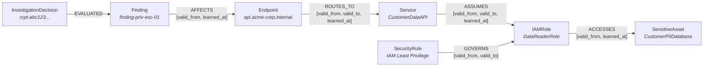
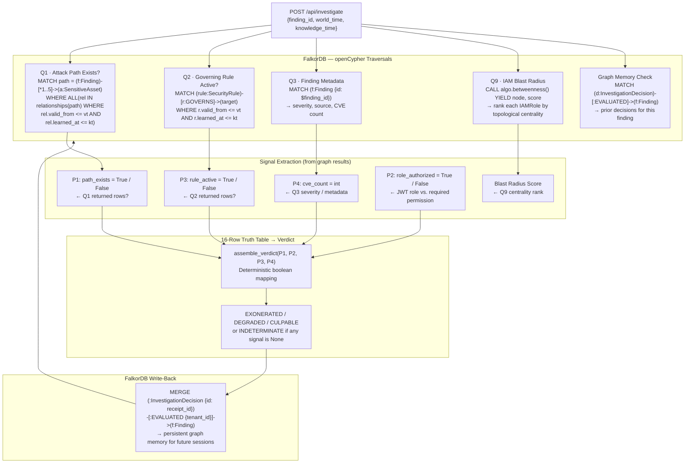
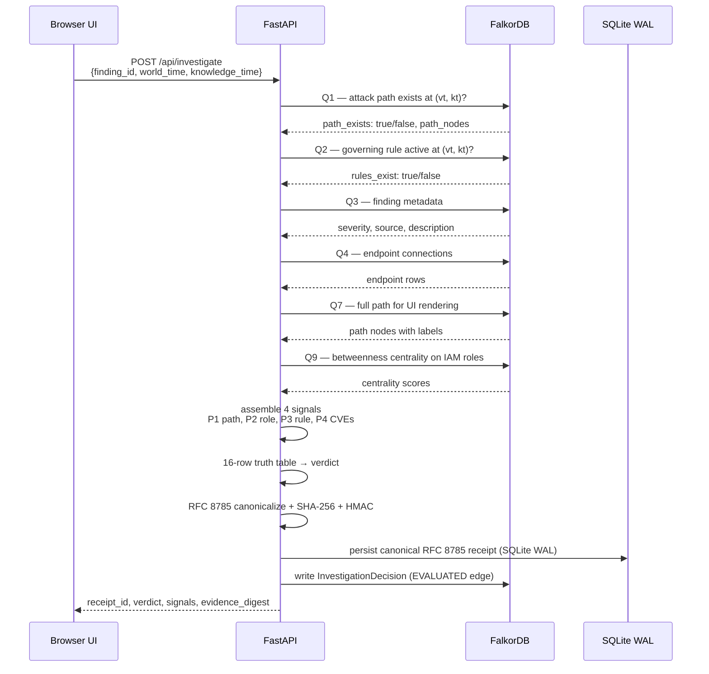
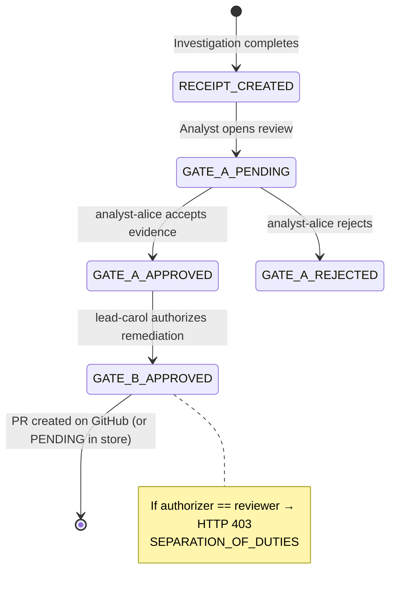

# Contextual

**Bitemporal graph audit defense and retrospective incident investigation engine built on FalkorDB.**

[](https://www.python.org/)
[](https://www.falkordb.com/)
[](https://react.dev/)
[](https://fastapi.tiangolo.com/)
[](https://github.com/aryaveerz/contextual)

---

## What this is

When a security team faces a compliance audit, the hard question is rarely *"is the infrastructure safe right now?"* It's *"was the infrastructure safe on the day that access request was approved six months ago?"*

Static audit logs record events but can't reconstruct what the network topology looked like, what IAM roles were connected to what, or what vulnerabilities a scanner had actually detected at that exact moment. Audits end up evaluating past decisions through the lens of present knowledge.

Contextual stores infrastructure relationships in FalkorDB, attaches two timestamps to every edge, and reconstructs historical point-in-time snapshots to evaluate whether past access grants and security decisions were sound given what was known then.

**Who this is for:**
- SOC2 Type II and FedRAMP teams who need to defend historical access approvals to auditors with verifiable snapshots of what was knowable at the time
- SecOps responders tracing stealth privilege escalation paths, proving when an attack vector first became active vs. when a scanner detected it
- CloudSec teams mapping effective multi-hop IAM reachability across microservices to sensitive databases

---

## Two clocks per edge

Standard audit logs record a single event timestamp. Contextual tracks two independently for every node and relationship:

```
World Time  (vt) --- When did this edge/permission exist in your infrastructure?
Knowledge Time (kt) --- When did your security team learn it existed?
```

Here's why that matters in practice:

```
Jan 1   IAM role attached to CustomerDataAPI silently
Jan 2   Security team reviews an access request - no attack path visible, approved
Jan 2   Scanner runs, picks up the IAM edge
Jan 5   Scanner correlates: IAM role can reach CustomerPIIDatabase
        Four-hop attack chain now visible in graph
        Previous approval now looks wrong - but was it negligent?
```

By setting both clocks to January 2, Contextual reconstructs the modeled infrastructure relationships and security information available at that point in time. If the complete attack path was discovered only on January 5, the earlier investigation can help establish whether that path was visible in the available graph evidence on January 2. This doesn't, by itself, prove that the infrastructure was safe or that the approval was justified.

---

## Why the graph can't be removed

There's an automated benchmark that compares the same investigation two ways. You can run it yourself:

```bash
python backend/tests/eval_graph_grounded.py
```

**Flat record inspection (no graph):**
- Reads the finding record in isolation
- Cannot traverse network topology
- Cannot see that 4 hops away there's a customer PII database
- Produces the same result on January 2 and January 5

**FalkorDB graph traversal:**
- Follows edges: Finding -> Endpoint -> Service -> IAMRole -> SensitiveAsset
- Applies both timestamps at every hop
- January 2: no complete path -> `DEGRADED`
- January 5: 4-hop chain visible -> `CULPABLE`

```
Condition                      Jan 2 result   Jan 5 result   Discrimination
-----------------------------------------------------------------------------
Flat record (no graph)         DEGRADED       DEGRADED       0%   <- blind
FalkorDB traversal             DEGRADED       CULPABLE       100% <- correct
```

Without graph traversal, the verdict is identical regardless of what changed in the infrastructure between those two dates. The graph is the engine, not an add-on.

---

## How the graph is structured

Every node and every edge carries `tenant_id` (for multi-tenant isolation), `valid_from`, `valid_to`, and `learned_at` timestamps. Here's the full schema:



**Node types:**

| Node | What it represents |
|---|---|
| `Finding` | A security finding from a scanner (AWS Access Analyzer, etc.) |
| `Endpoint` | A network-accessible entry point |
| `Service` | An internal service (API, worker, gateway) |
| `IAMRole` | An IAM role or permission assignment |
| `SensitiveAsset` | A protected resource (PII database, financial vault) |
| `SecurityRule` | A governing policy rule (IAM Least Privilege, Zero Trust) |
| `InvestigationDecision` | A persisted investigation decision (agent memory across sessions) |

The `ASSUMES` edge from Service to IAMRole is what makes the January 2 to January 5 transition critical. That edge's `learned_at` is January 2 (when the scanner found it), but the attack path to `SensitiveAsset` doesn't complete until the `ACCESSES` edge is discovered on January 5. Both timestamps are checked independently at every hop.

Every openCypher query enforces this temporal and multi-tenant bounding predicate:

```cypher
WHERE ALL(rel IN relationships(path) WHERE
    rel.tenant_id = $tenant_id
    AND rel.valid_from <= $vt
    AND (rel.valid_to IS NULL OR rel.valid_to > $vt)
    AND rel.learned_at <= $kt
)
```

The `relationships(path)` list comprehension is FalkorDB-specific. Neo4j uses a different syntax; this query will not work unchanged on other graph databases.

---

## How the agent queries FalkorDB to make decisions

Every verdict the agent returns traces directly to openCypher traversals against FalkorDB. There's no LLM generating conclusions -- the graph structure at the requested `(world_time, knowledge_time)` pair *is* the evidence.



FalkorDB answers three questions for every investigation:

| Query | What FalkorDB traverses | Signal produced |
|---|---|---|
| Q1 - Topology | `(Finding)-[:AFFECTS]->(Endpoint)-[:ROUTES_TO]->(Service)-[:ASSUMES]->(IAMRole)-[:ACCESSES]->(SensitiveAsset)` at `(vt, kt)` | P1: does a complete attack path exist? |
| Q2 - Policy | `(SecurityRule)-[:GOVERNS]->(IAMRole)` at `(vt, kt)` | P3: is a governing compliance rule actively covering this role? |
| Q9 - Centrality | `CALL algo.betweenness()` across the full tenant graph | Blast radius rank: which IAM role is most topologically central and highest priority for remediation |

If you swap FalkorDB out for a flat database lookup, P1 collapses to a simple attribute check on the finding record. It can't traverse the 4-hop chain, it can't apply the temporal fence at each hop, and January 2 and January 5 become indistinguishable. The benchmark confirms this with 0% temporal discrimination. The graph is the engine, not an add-on.

After every investigation, the agent writes an `(:InvestigationDecision)` node back into FalkorDB connected by an `[:EVALUATED]` edge to the finding. Future investigations by any authenticated analyst on the same tenant can query this history directly via graph traversal, without joining a separate audit table.

---

## How an investigation runs



Storage:
- **FalkorDB** stores `InvestigationDecision` vertices and `EVALUATED` edges so any analyst on the same tenant can query prior decisions through graph traversal in future sessions
- **SQLite (WAL mode)** stores the tamper-evident RFC 8785 canonical JSON receipts and pending remediation proposals for durable local retrieval

The 4 signals feed a deterministic truth table. Every combination of (P1, P2, P3, P4) maps to exactly one verdict:

| P1 Path | P2 Role | P3 Rule | P4 CVEs | Verdict |
|:---:|:---:|:---:|:---:|---|
| ✗ | ✓ | ✓ | 0 | **EXONERATED** - certified compliant |
| ✓ | ✓ | ✓ | 0 | **EXONERATED** - intended architecture path |
| ✗ | ✓ | ✓ | >0 | **DEGRADED** - isolated CVE, no path |
| ✓ | ✓ | ✓ | >0 | **CULPABLE** - approved path carries active CVE |
| ✓ | ✓ | ✗ | 0 | **CULPABLE** - traffic active under expired rule |
| ✓ | ✗ | ✓ | 0 | **CULPABLE** - shadow privilege escalation |
| ✓ | ✗ | ✗ | >0 | **CULPABLE** - catastrophic compromise state |
| ✗ | ✗ | ✗ | 0 | **DEGRADED** - multiple policy misalignments |

All 16 rows are tested parametrically in `backend/tests/test_16row_truth_table.py`. If any signal is missing or invalid, the engine fails closed to **INDETERMINATE** with reason `SIGNAL_ERROR`.

---

## Two-man governance

When a verdict comes back `CULPABLE`, it enters a review workflow before any remediation can be authorized:



The separation of duties check is enforced strictly by the backend. If the user who approved Gate A tries to authorize Gate B, the API aborts with `HTTP 403 SEPARATION_OF_DUTIES`. Identities come exclusively from the verified JWT `sub` claim; client-submitted reviewer IDs are ignored.

If `GITHUB_TOKEN` and `GITHUB_REPO` are set in `.env`, Gate B creates a real GitHub pull request via the REST API. If they're not configured, the proposal is persisted in SQLite with state `PENDING`.

---

## Decision history across sessions

Every investigation writes an `InvestigationDecision` node to FalkorDB with an `EVALUATED` edge pointing back to the finding. This is the persistent memory.

A different user, in a completely separate session, can retrieve the full history:

```
GET /api/investigate/{finding_id}/history
```

This queries FalkorDB directly, traversing `EVALUATED` relationships to retrieve historical `InvestigationDecision` vertices recorded for that finding under the caller's tenant. The response includes the original temporal coordinates and the RFC 8785 digest so the receipt can be re-verified.

---

## What's in the box

| Capability | Implementation | Tests |
|---|---|---|
| Graph-grounded investigation | `POST /api/agent/investigate` runs 3 bounded openCypher tool passes (topology probe, rule check, path enumeration) and calculates betweenness centrality on IAM nodes. Verdicts come from graph topology, not an LLM. If GitHub credentials are configured, remediations emit real pull requests via REST API v3. | `test_all_endpoints_live.py`, `test_centrality_algorithm.py` |
| Decision history | Past decisions are stored as `InvestigationDecision` graph vertices with `EVALUATED` relationships in FalkorDB. Any authorized analyst retrieves them across sessions via `GET /api/investigate/{id}/history` without relational joins. | `test_graph_memory_and_tenant_isolation.py` |
| Two-man governance | Strict two-gate lifecycle: Gate A analyst disposition and Gate B lead authorization. Identity comes exclusively from the JWT `sub` claim. If `authorizer_id == reviewer_id`, the backend aborts with `HTTP 403 SEPARATION_OF_DUTIES`. | `test_gate_b_proposals_hardening.py` |
| Graph ablation benchmark | Multi-hop breach detection requires relational path traversal. Flat finding inspection yields 0% temporal discrimination; FalkorDB bitemporal traversal achieves 100%. | `python backend/tests/eval_graph_grounded.py` |

---

## MCP server

The investigation engine is also available as a Model Context Protocol server at `/mcp/sse`. Three tools:

- `investigate_finding` - full investigation, returns signed receipt
- `query_attack_path` - attack path check at given (vt, kt)
- `get_decision_history` - prior decisions from graph memory

Tenant identity comes from the JWT in the MCP session. Callers can't inject `tenant_id` through tool arguments -- the schemas explicitly exclude it.

---

## Getting started

### Prerequisites

- Docker and Docker Compose (handles everything, recommended)
- Or: Python 3.11+, Node 18+, and FalkorDB running on port 6379

### Running with Docker Compose

This is the fastest way to get everything running. One command starts FalkorDB, the backend, the React frontend, and the Nginx proxy together.

```bash
git clone https://github.com/aryaveerz/contextual.git
cd contextual

cp .env.example .env

docker compose up -d

# FalkorDB takes ~10 seconds to become healthy, then seed the graph:
docker compose exec backend python fixtures/seed_graph.py --write

# Discover the dynamically assigned loopback URLs:
python scripts/get_urls.py

# Or inspect the frontend port directly:
docker compose port frontend 80
```

- **Web UI & Unified API Proxy:** Reported by `scripts/get_urls.py` (or `http://localhost:3000` if pinned)
- **API Docs (Swagger UI):** `http://<web-ui-host>/docs`
- **MCP SSE endpoint:** `http://<web-ui-host>/mcp/sse`

By default Docker picks a free loopback port automatically so it doesn't clash with anything already running. If you want fixed ports:

```bash
FRONTEND_PORT=3000 BACKEND_PORT=8000 docker compose up -d
```

To tear down when done:

```bash
docker compose down
```

### Resetting to a clean baseline

When you clone the repository, the state is completely clean out of the box (`data/audit_store.db` is gitignored). If you run investigations or approve Gate A / Gate B governance reviews and want to return to a fresh baseline:

```bash
docker compose down -v
rm -f data/audit_store.db*       # Windows PowerShell: Remove-Item -Force .\data\audit_store.db* -ErrorAction SilentlyContinue
docker compose up -d
docker compose exec backend python fixtures/seed_graph.py --write
```

Or run the automated reset script:

```bash
python scripts/reset.py
```

---

### Running locally without Docker

If you want to run the backend and frontend separately -- for example when making code changes -- open three terminals:

```bash
# Terminal 1 — FalkorDB
docker run -d --name falkordb -p 6379:6379 falkordb/falkordb:latest

# Terminal 2 — Backend
cd backend
python -m venv .venv
source .venv/bin/activate        # Windows: .venv\Scripts\activate
pip install -r requirements.txt
python fixtures/seed_graph.py --write
uvicorn app.main:app --host 0.0.0.0 --port 8000 --reload

# Terminal 3 — Frontend
cd frontend
npm install
npm run dev                      # http://localhost:5173 (Vite dev server)
```

In this setup the frontend talks directly to port 8000; Nginx is not involved.

---

### Running the tests

The test suite requires a live FalkorDB instance. If you already have Docker Compose running, FalkorDB is up and the tests can connect to it straight away.

```bash
cd backend
python -m pytest tests/ -v
```

83 tests across 13 suites, expected result is 83 passed, 0 failed. To run the graph-vs-flat ablation benchmark on its own:

```bash
python backend/tests/eval_graph_grounded.py
```

---

### Authentication

There is no login screen. The app authenticates itself -- when you open the UI and click Investigate, it fetches a JWT in the background and attaches it to every request. You don't need to type credentials anywhere.

Internally the app uses three identities:

| Identity | Role | Tenant |
|---|---|---|
| `analyst-alice-01` | Security Analyst | tenant-corp-alpha |
| `lead-carol-01` | Security Lead | tenant-corp-alpha |
| `lead-dave-beta` | Security Lead | tenant-corp-beta |

The Governance tab lets you switch between Alice and Carol to walk through the two-man rule. Alice accepts the evidence at Gate A; Carol authorizes remediation at Gate B. If you try to use the same identity for both gates, the backend returns `HTTP 403 SEPARATION_OF_DUTIES` regardless of what the UI says.

Dave is on a separate tenant. Any request to Alpha's findings as Dave returns `404` rather than `403`, so resource existence is never leaked across tenant boundaries.

---

## Walking through the demo

**Step 1: Baseline state (January 2, 2026)**

Click the "Baseline (Jan 02)" preset. Both sliders move to January 2. Click Investigate.

The graph shows the finding, endpoint, and service but the path stops there. The `ACCESSES` edge connecting the IAM role to the PII database hasn't been discovered yet. Verdict: `DEGRADED`.

**Step 2: Breach discovery (January 5, 2026)**

Click "Breach Discovery (Jan 05)" or drag the world time slider forward. Investigate again.

The graph expands: a 4-hop path lights up connecting `finding-priv-esc-01` through to `CustomerPIIDatabase`. Signal P1 flips to true. Verdict: `CULPABLE`.

**Step 3: Traversal depth exploration**

Drag the Hop Depth slider (left sidebar) from 1 to 5. At depth 1 you see immediate neighbors; at depth 5 you see the full chain including the governing security rule.

**Step 4: Gate A evidence review**

Switch to the Governance tab. Click "Accept Evidence" as Alice. Gate A turns green.

**Step 5: Separation of duties enforcement**

With Alice's identity still active in the Governance tab, try to authorize Gate B. The server returns `HTTP 403 SEPARATION_OF_DUTIES`. The check runs on the backend regardless of UI state.

**Step 6: Gate B remediation authorization**

Switch the Governance tab to Carol (`lead-carol-01`). Authorize the remediation proposal. Without GitHub credentials configured it persists as `PENDING`; with them, a real PR is created.

**Step 7: Decision history**

Switch the tenant selector back to Alpha and open the history for `finding-priv-esc-01`. Alice's earlier investigation appears -- different identity, shared graph memory.

---

## Test suite

```bash
cd backend
python -m pytest tests/ -v
```

83 tests, 13 suites. Must be run against a live FalkorDB instance. Covers:

- All 16 policy truth table rows (parametrized)
- RFC 8785 canonicalization and tamper detection
- Multi-tenant IDOR isolation
- Separation of duties enforcement
- Rate limiting (60 req/min sliding window per JWT identity)
- OWASP security headers on every response
- MCP tool discovery, schema validation, SSE transport
- Bitemporal temporal discrimination
- Graph ablation benchmark

Graph proof specifically:

```bash
python backend/tests/eval_graph_grounded.py
```

---

## Security notes

**No client-declared identity.** `reviewer_id` and `authorizer_id` are always taken from the JWT `sub` claim server-side. Fields with those names in request bodies are ignored.

**404 not 403 for cross-tenant access.** Returning 403 would confirm the resource exists. The API returns 404 to avoid leaking resource existence across tenant boundaries.

**Rate limiting is per JWT identity, not IP.** The dual-clock sliders can trigger rapid API calls during interactive scrubbing. The server enforces a sliding window of 60 requests/minute per `{tenant_id}:{sub}` key.

**Receipts are cryptographically sealed.** The evidence payload is serialized via RFC 8785 (deterministic key ordering, no whitespace), hashed with SHA-256, and signed with HMAC-SHA256. Any modification to a stored receipt fails verification. This gives tamper-evident integrity for audit records, though it relies on secure key management and doesn't provide write-once hardware immutability.

---

## Project layout

```
contextual/
├── backend/
│   ├── app/
│   │   ├── assembly/          16-row policy truth table
│   │   ├── auth/              JWT verification and role enforcement
│   │   ├── graph/             FalkorDB queries, bitemporal engine, graph memory
│   │   ├── lifecycle/         Investigation state machine
│   │   ├── mcp/               MCP SSE server
│   │   ├── middleware/        Tenant context, security headers, rate limiting
│   │   ├── routers/           REST endpoints
│   │   ├── security/          RFC 8785 canonicalizer
│   │   ├── services/          Investigation orchestration
│   │   └── storage/           SQLite WAL store
│   ├── fixtures/
│   │   ├── seed_graph.py      Seeds bitemporal scenario into FalkorDB
│   │   └── check_before_push.py  Cypher AST and secret scanner
│   └── tests/                 83 tests, 13 suites
├── frontend/
│   ├── nginx.conf             Reverse proxy routing /api, /mcp, /docs
│   └── src/
│       ├── components/        Graph canvas, dual-clock slider, governance panel
│       └── services/          Backend API client
├── scripts/
│   ├── get_urls.py            Dynamic port and URL discovery tool
│   └── reset.py               Automated teardown and graph reseeding tool
└── docker-compose.yml
```

---

## AI disclosure

Contextual was built using Google Antigravity IDE (Gemini) as a pair-programming tool during development. Core system design, bitemporal openCypher queries, truth table logic, and security rules were planned and directed by me. The AI was used for drafting tests, building React UI components, and writing routine boilerplate. All generated code was reviewed, tested, and verified manually.
